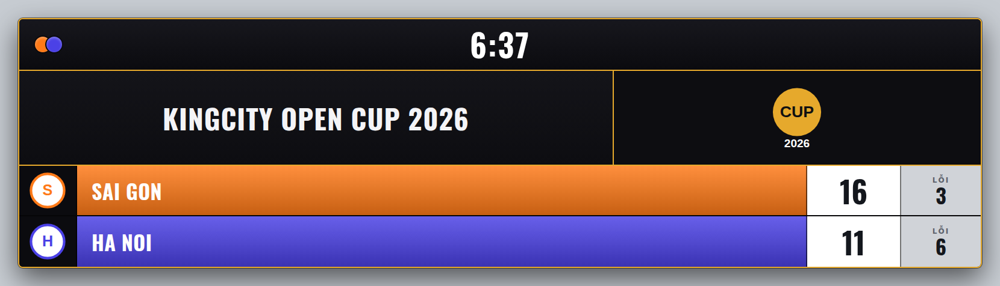

# 🏀 Bảng điểm Bóng rổ 3x3 cho vMix & OBS

Bảng điểm bóng rổ **3x3** dùng cho livestream — nền trong suốt để phủ lên video trong **OBS hoặc vMix**, **bấm điểm real-time** từ máy tính / điện thoại / tablet, hoặc điều khiển bằng **phím tắt vMix / Stream Deck** qua API HTTP.

Đúng theo thiết kế: khung viền vàng · thanh trên có **2 chấm màu đội + thời gian tổng** · **2 ô lớn** (trái = **tên giải**, phải = **logo giải thay được**) · thanh điểm **2 đội xếp dọc** gồm **logo đội · tên · điểm · lỗi**.

Chỉ hiển thị đúng thứ 3x3 cần: **THỜI GIAN TỔNG · ĐIỂM · LỖI** (không hiệp, không đồng hồ 24 giây).



---

## 1. Yêu cầu

- **Node.js** (14 trở lên) — tải tại <https://nodejs.org> (bản LTS).
- **OBS** (nguồn *Browser*) **hoặc vMix** (input *Web Browser*).
- Không cần cài thêm thư viện nào khác.

## 2. Chạy máy chủ

**Cách dễ nhất:** bấm đúp **`start.bat`** (Windows) hoặc **`start.command`** (macOS). Giữ cửa sổ đó mở suốt buổi live.

Hoặc mở Terminal / CMD tại thư mục dự án:

```bash
node server.js
```

Sẽ in ra:

```
• Bảng điều khiển : http://localhost:8000/control
• Bảng điểm (OBS) : http://localhost:8000/scoreboard
```

> Đổi cổng: `PORT=9000 node server.js` (Windows CMD: `set PORT=9000 && node server.js`).

## 3. Đưa bảng điểm vào OBS hoặc vMix

**OBS:** Sources **+ → Browser** → **URL** `http://localhost:8000/scoreboard` → **Width 1920 / Height 1080** → bỏ tick *"Shutdown source when not visible"* → **OK**. Nền trong suốt sẵn.

**vMix:** **Add Input → Web Browser** → URL như trên → **1920 × 1080** → kéo lên Overlay.

Tinh chỉnh bằng tham số URL (thêm vào cuối URL):

| Tham số | Ý nghĩa | Ví dụ |
|---|---|---|
| `scale` | Phóng to / thu nhỏ | `/scoreboard?scale=0.9` |
| `y` | Khoảng cách tới cạnh trên (px) | `/scoreboard?y=40` |
| `pos` | `center` = đặt giữa màn hình | `/scoreboard?pos=center` |

## 4. Bấm điểm (bảng điều khiển)

Mở `http://localhost:8000/control` — trên **máy chạy OBS**, hoặc trên **điện thoại/tablet** cùng Wi‑Fi (dùng địa chỉ IP in trong cửa sổ đen, ví dụ `http://192.168.1.10:8000/control`).

- **Điểm 3x3:** **+1** (trong vạch / ném phạt) và **+2** (ngoài vạch), kèm **−1** để sửa.
- **Lỗi:** +1 / −1 cho mỗi đội.
- **Thời gian tổng:** Chạy/Dừng, Reset (về 10:00), ±1 giây, hoặc gõ `mm:ss` rồi **Đặt giờ**.
- **Ẩn/Hiện tên giải** (2 ô lớn), **Ẩn/Hiện bảng**, **Đổi bên**, **Trận mới**.
- **Cài đặt:** tên đội, màu ô & màu chữ, **logo đội**, **tên giải**, **logo giải**, phút/trận.

### Phím tắt (khi con trỏ không nằm trong ô nhập)

| Phím | Tác dụng |
|---|---|
| `Q` / `W` | Đội A +1 / +2 |
| `A` | Đội A −1 · `Z` Đội A lỗi +1 |
| `I` / `O` | Đội B +1 / +2 |
| `K` | Đội B −1 · `M` Đội B lỗi +1 |
| `Space` | Chạy / dừng đồng hồ · `R` reset đồng hồ |
| `H` | Ẩn / hiện bảng · `B` ẩn / hiện tên giải |

## 5. Điều khiển bằng vMix / Stream Deck (nâng cao)

Mọi thao tác là một URL HTTP `GET`. Trong vMix tạo input **Web Browser** ẩn rồi dùng shortcut **Navigate** tới URL; Stream Deck dùng action **Website**.

```
http://localhost:8000/cmd?action=score&team=home&points=2   → đội A +2
http://localhost:8000/cmd?action=score&team=away&points=1   → đội B +1
http://localhost:8000/cmd?action=foul&team=home&delta=1     → lỗi đội A +1
http://localhost:8000/cmd?action=clock&op=toggle            → chạy/dừng đồng hồ
http://localhost:8000/cmd?action=clock&op=reset             → về 10:00
```

## 6. Bảng lệnh API

Gọi `GET /cmd?...` (hoặc `POST /cmd` JSON). `team` = `home` (đội A / ô cam) | `away` (đội B / ô xanh).

| action | Tham số | Mô tả |
|---|---|---|
| `score` | `team`, `points` (1, 2, -1) | Cộng/trừ điểm |
| `setScore` | `team`, `value` | Đặt điểm cụ thể |
| `foul` | `team`, `delta` | Cộng/trừ lỗi |
| `setFoul` | `team`, `value` | Đặt số lỗi |
| `clock` | `op=start\|stop\|toggle\|reset\|set\|adjust`, `value` | Thời gian tổng (`value` dạng `mm:ss` hoặc giây) |
| `set` | `path`, `value` | Đặt trường bất kỳ: `teams.home.name`, `teams.away.color`, `teams.home.logo`, `tournament`, `eventLogo`, `periodMinutes` |
| `visible` | `value=true\|false\|toggle` | Ẩn / hiện bảng |
| `banner` | `value=true\|false\|toggle` | Ẩn / hiện 2 ô lớn (tên giải + logo) |
| `swap` | — | Đổi bên hai đội |
| `resetScores` | — | Xoá điểm & lỗi |
| `reset` | — | Trận mới (giữ nhận diện đội) |

Khác: `GET /state` (JSON), `GET /events` (SSE real-time).

## 7. Logo (thay được)

- **Logo giải** (ô lớn bên phải): mục *Cài đặt → Giải đấu → Logo giải*.
- **Logo đội** (ô đen cạnh ô màu): mục *Cài đặt → Đội A / Đội B → Logo đội*.

Mỗi ô nhập nhận **link ảnh online**, hoặc bỏ file ảnh vào thư mục `public/` rồi ghi `/tên-file.png` (nên dùng ảnh nền trong suốt `.png`).

## 8. Cấu trúc thư mục

```
server.js            Máy chủ Node (tĩnh + SSE + API) — không cần thư viện ngoài
start.bat / .command Bấm đúp để chạy (Windows / macOS)
public/
  index.html         Trang chọn (control / scoreboard)
  scoreboard.*       Bảng điểm on-air (thêm vào OBS/vMix)
  control.*          Bảng điều khiển bấm điểm
  fonts.css, fonts/  Font Oswald (kèm tiếng Việt) — nhúng nội bộ, chạy offline
```

## 9. Mẹo

- Trạng thái lưu trong bộ nhớ server; **khởi động lại** sẽ về mặc định (0–0, 10:00).
- Đồng hồ chạy **mượt** vì tính theo mốc thời gian server — nhiều máy xem vẫn khớp.
- Bộ này chạy **offline ngay trên máy bạn**, không hết hạn, không tài khoản, không phí.
