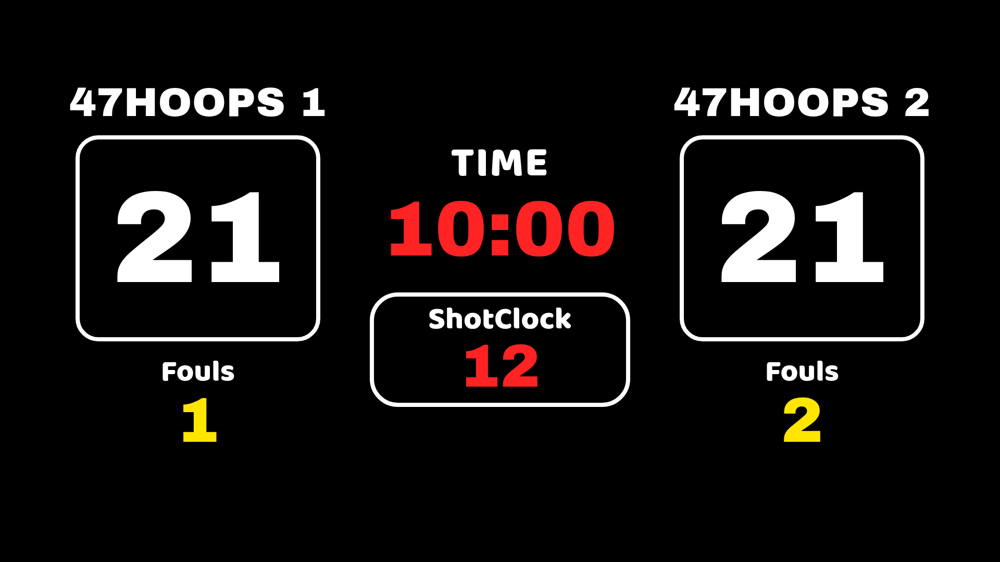

# 🏀 Bảng điểm bóng rổ cho vMix & OBS — 1 điều khiển, 2 màn hình

Một **bảng điều khiển** duy nhất, điều khiển **2 màn hình hiển thị đồng bộ real-time**:

- **📺 Bảng điểm TV** (`/tv`) — full màn hình, chiếu lên **TV / màn LED** tại sân (thiết kế 47HOOPS: điểm to, TIME, ShotClock, Fouls).
- **🔴 Bảng điểm Live** (`/scoreboard`) — thanh **nghiêng** nền trong suốt, thêm vào **OBS/vMix** phủ lên video livestream.

Bấm 1 nút → **cả TV lẫn Live đều nhảy cùng lúc**. TV **bên trái = đội 1** (hàng trên bảng điều khiển), TV **bên phải = đội 2** (hàng dưới).

| Bảng TV (`/tv`) | Bảng Live (`/scoreboard`) |
|---|---|
|  |  |

---

## 1. Yêu cầu

- **Node.js** (14 trở lên) — tải tại <https://nodejs.org> (bản LTS).
- **OBS** (nguồn *Browser*) và/hoặc **vMix** (input *Web Browser*); TV nối bằng HDMI hoặc mở trình duyệt full màn hình.
- Không cần cài thêm thư viện nào khác.

## 2. Chạy máy chủ

**Cách dễ nhất:** bấm đúp **`start.bat`** (Windows) hoặc **`start.command`** (macOS). Giữ cửa sổ đó mở suốt buổi live.

Hoặc: `node server.js`. Sẽ in ra:

```
• Bảng điều khiển : http://localhost:8000/control
• Bảng điểm (OBS) : http://localhost:8000/scoreboard
```

## 3. Ba đường dẫn

| Đường dẫn | Dùng để | Mở ở đâu |
|---|---|---|
| `/control` | Bấm điểm, giờ, foul, ShotClock | Máy tính / điện thoại / tablet |
| `/tv` | Bảng điểm chiếu lên TV (full màn hình) | Trình duyệt full màn hình trên màn TV/HDMI |
| `/scoreboard` | Bảng live nghiêng (nền trong suốt) | Nguồn *Browser* trong OBS/vMix (1920×1080) |

**Đưa bảng Live vào OBS:** Sources **+ → Browser** → URL `http://localhost:8000/scoreboard` → **1920 × 1080** → bỏ tick *"Shutdown source when not visible"*.
**Bảng TV:** mở `http://localhost:8000/tv` trên trình duyệt rồi bấm **F11** (full màn hình) trên màn hình/TV thứ hai. (Cũng có thể thêm làm nguồn Browser nếu muốn chèn vào cảnh.)

Tham số URL cho `/scoreboard`: `?scale=`, `?x=`, `?y=` (vị trí/tỉ lệ). Cho `/tv`: `?` không cần — tự co giãn vừa màn hình.

## 4. Bấm điểm (bảng điều khiển)

Mở `http://localhost:8000/control` — trên **máy chạy OBS**, hoặc **điện thoại/tablet** cùng Wi‑Fi (địa chỉ IP in trong cửa sổ đen).

- **Điểm:** +1 / +2 / +3 và −1. **Fouls:** +1 / −1.
- **Thời gian:** Chạy/Dừng, Reset, ±1 giây, hoặc gõ `mm:ss` → **Đặt giờ**.
- **ShotClock:** 24s / 14s / Chạy‑Dừng / **Ẩn‑Hiện**.
- **Ẩn/Hiện bảng live**, **Đổi bên**, **Trận mới**.
- **Cài đặt:** tên đội, **nhãn** (U16…), **tên giải**, phút/trận.
- **Màu áo** (chip bảng live): chọn bằng **bảng màu bấm nhanh**, ô chọn màu, hoặc gõ **mã màu** `#rrggbb`.
- **Logo giữa** (bảng TV): bấm **📁 Tải lên** để chọn ảnh từ máy (tự lưu, tự áp), hoặc dán đường dẫn `/logo.png` / link online.

### Phím tắt (khi con trỏ không nằm trong ô nhập)

| Phím | Tác dụng |
|---|---|
| `Q` / `W` / `E` · `A` · `Z` | Đội 1 +1/+2/+3 · −1 · foul +1 |
| `U` / `I` / `O` · `K` · `M` | Đội 2 +1/+2/+3 · −1 · foul +1 |
| `Space` · `R` | Chạy/dừng giờ · reset giờ |
| `S` · `D` · `F` · `V` | 24s · 14s · chạy/dừng 24s · ẩn/hiện 24s |
| `H` | Ẩn / hiện bảng live |

## 5. Điều khiển bằng vMix / Stream Deck

Mọi thao tác là URL HTTP `GET` (vMix *Navigate*, Stream Deck *Website*, hoặc điện thoại):

```
/cmd?action=score&team=home&points=2     → đội 1 +2
/cmd?action=foul&team=away&delta=1       → foul đội 2 +1
/cmd?action=clock&op=toggle              → chạy/dừng giờ
/cmd?action=shotclock&op=reset&value=24  → 24 giây
/cmd?action=shotclock&op=togglevis       → ẩn/hiện 24s
```

## 6. Bảng lệnh API

`GET /cmd?...`. `team` = `home` (đội 1 / TV trái) | `away` (đội 2 / TV phải).

| action | Tham số | Mô tả |
|---|---|---|
| `score` / `setScore` | `team`, `points`/`value` | Điểm |
| `foul` / `setFoul` | `team`, `delta`/`value` | Foul |
| `clock` | `op=start\|stop\|toggle\|reset\|set\|adjust`, `value` | Thời gian (`mm:ss` hoặc giây) |
| `shotclock` | `op=start\|stop\|toggle\|reset\|set\|show\|hide\|togglevis`, `value` | Đồng hồ 24s |
| `set` | `path`, `value` | `category`, `tournament`, `logo`, `teams.home.name`, `teams.away.color`, `periodMinutes` |
| `visible` | `value=true\|false\|toggle` | Ẩn/hiện bảng live |
| `swap` · `resetScores` · `reset` | — | Đổi bên · xoá điểm/foul · trận mới |

Khác: `GET /state` (JSON), `GET /events` (SSE real-time).

## 7. Cấu trúc thư mục

```
server.js            Máy chủ Node (tĩnh + SSE + API)
start.bat / .command Bấm đúp để chạy (Windows / macOS)
public/
  index.html         Trang chọn 3 màn
  tv.*               Bảng điểm TV (full màn hình)
  scoreboard.*       Bảng điểm live (nghiêng, trong suốt)
  control.*          Bảng điều khiển
  fonts.css, fonts/  Font Oswald (kèm tiếng Việt) — nhúng nội bộ, offline
```

## 8. Mẹo

- Cả 2 màn hình đọc **chung một trạng thái** trên server → luôn khớp nhau.
- Trạng thái lưu trong bộ nhớ server; **khởi động lại** sẽ về mặc định (0–0, 10:00).
- Đồng hồ chạy **mượt** vì tính theo mốc thời gian server.
- Chạy **offline ngay trên máy bạn** — không hết hạn, không tài khoản, không phí.
